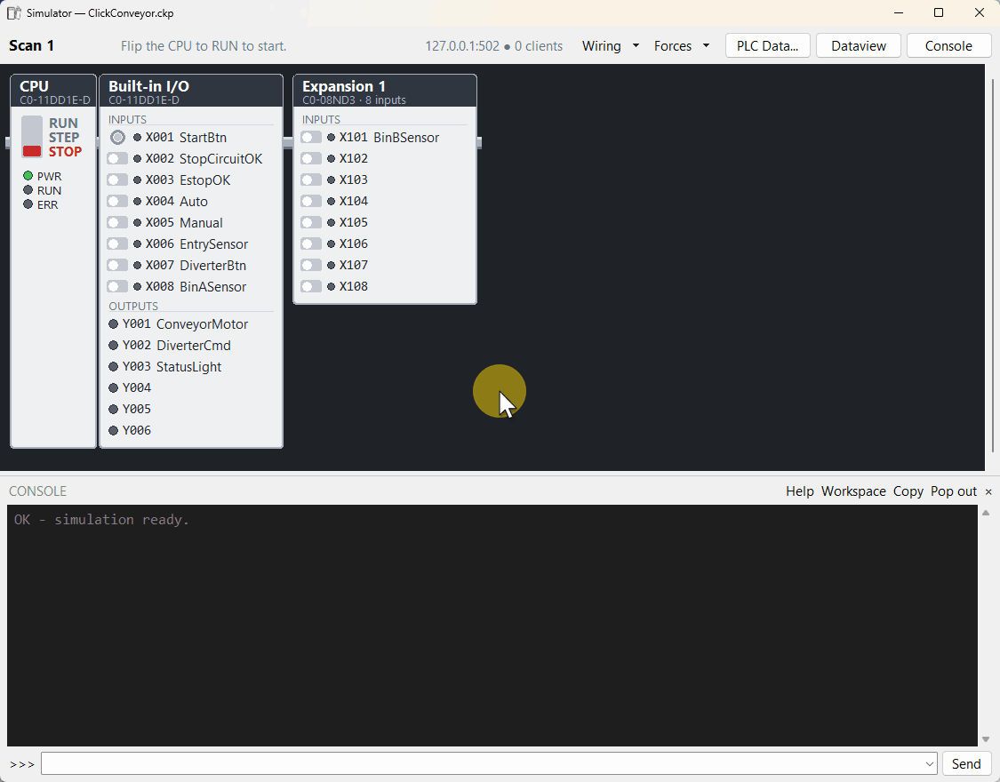

# Better tools for AutomationDirect CLICK PLCs

CLICK Programming Software has no simulator. ClickNick adds one: run your saved program on your laptop, work the switches, and ask why an output did or didn't come on.

pyrung, the engine underneath, is checked against a real CLICK, case by case: [conformance results](https://pyrung.com/pyrung/guides/conformance/) · [how it was built](https://pyrung.com/blog/click-plc-simulator/).

> **ClickNick never edits your `.ckp`.** Nothing becomes part of the project until you save in CLICK Programming Software. [Where ClickNick writes.](help/index.md#where-clicknick-writes)

> **Not official, not affiliated.** ClickNick is an independent project, not endorsed by AutomationDirect. The simulator and checks don't replace testing. Test on the real machine, with proper safeguards, before anything interacts with people.

[Take the tour](tour/simulator.md){ .md-button .md-button--primary } [Install ClickNick](install.md){ .md-button }

Also: nickname autocomplete, the Address Editor, Check Program and Review Changes, and your ladder as Python after every save.

## Why

CLICK is inexpensive, approachable, and easy to troubleshoot. That simplicity is a feature. What's missing is around the editor: you type `C123` because you can't type nicknames, nothing checks the program before the machine runs it, there's no simulator to try it on, and last month's logic lives in `Machine_FINAL_FINAL.ckp`. ClickNick fixes those without replacing CLICK Programming Software.

## Who it's for

Anyone who programs CLICK PLCs, from the one-person shop to the integrator with fifty projects on the shelf. You don't need Git, Python, or an AI to get something out of it: start with autocomplete, open the Address Editor when it helps, run Check Program when you want another set of eyes. If you do want tests and history for a machine, they're one workspace away.

Built on [pyrung](https://pyrung.com/pyrung/), the engine that runs your ladder as Python. [How it fits.](https://pyrung.com/overview/)

## Get started

Two steps: install `uv`, then `uv tool install clicknick`. [Install](install.md) · [Take the tour](tour/simulator.md)
