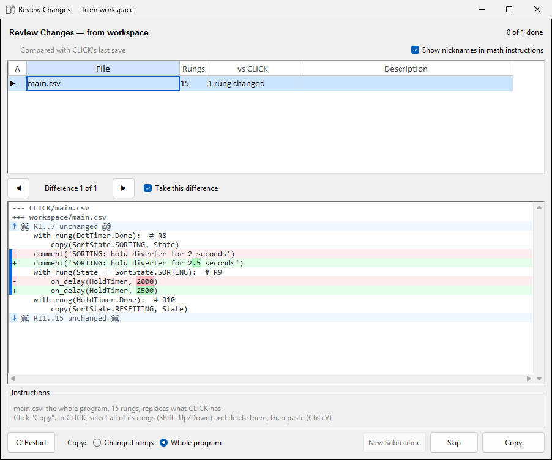

# Still saving `Machine_FINAL_FINAL.ckp`?

**Tour 4 of 6**

A `.ckp` can't show you what changed. Text can:

Every time you save in CLICK, ClickNick writes your ladder (as Python) into the workspace folder. Any comparison tool then shows the changed timer preset, contact, comment, or rung: WinMerge, GitHub Desktop, VS Code, Git, or two folders side by side. Git is optional. What matters is that every save leaves a copy you can compare with the last one.

When you edit that text yourself, **Review Changes** shows the difference rung by rung before anything goes back into CLICK.

---

**[Next: Keep the engineering work with the CLICK project →](engineering-workspace.md)**
